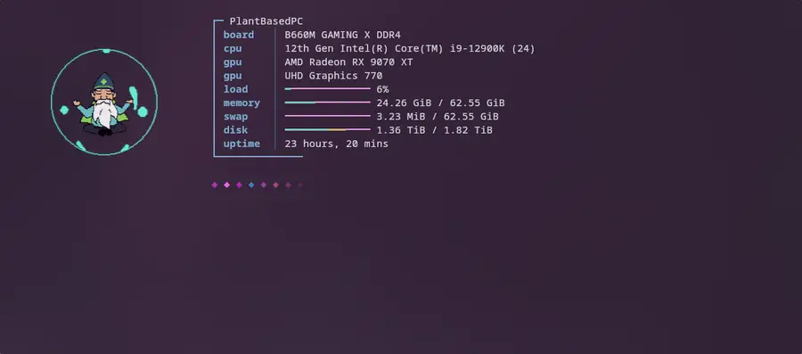
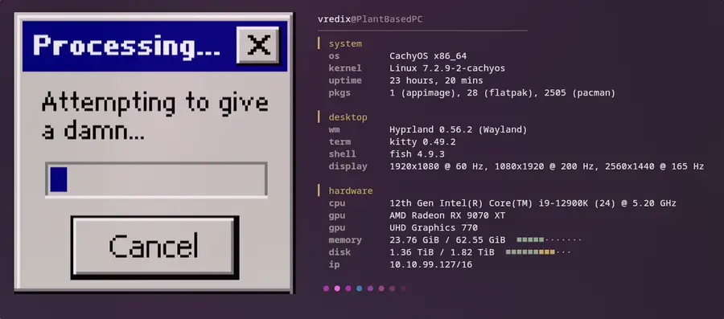
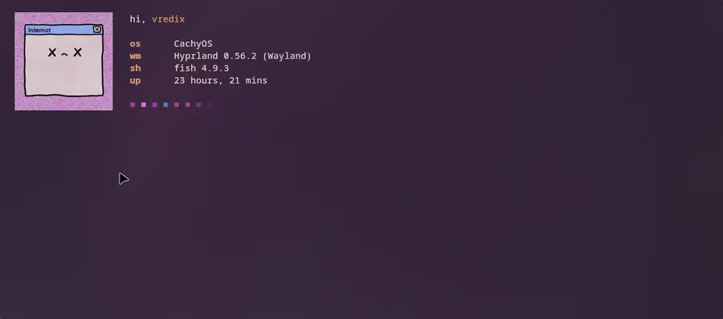

<div align="center">


<br>
<br>
<picture>
  <source media="(prefers-color-scheme: dark)"  srcset="assets/icons/banner-white.png">
  <source media="(prefers-color-scheme: light)" srcset="assets/icons/banner-black.png">
  
</picture>

<br>
<br>
<br>

**gifetch** puts an animated GIF next to your fastfetch output.

<sub><a href="https://pixabay.com/gifs/elder-wizard-meditation-fantasy-26145/">Default GIF</a> by <a href="https://pixabay.com/users/kuzu420-42489797/">Kuzu420</a> on Pixabay</sub>

</div>

Made for the kitty terminal. fastfetch alone only shows the first frame of a GIF. gifetch plays
the whole thing and uses your installed fastfetch, so all its options keep working.

<br>
<br>

<table><tr><td width="33%"></td><td width="33%"></td><td width="33%"></td></tr></table>

<br>

## Install

```fish
yay -S gifetch
```

Or from source: `git clone https://github.com/vredix-openvuture/gifetch.git && ./gifetch/install.sh`
links the command into `~/.local/bin` (`./install.sh --uninstall` removes it).

Needs kitty 0.28 or newer, fastfetch and Python 3. Outside kitty, in tmux or screen and in pipes
gifetch prints plain fastfetch. To greet every new shell, call `gifetch` from fish's
`fish_greeting` (or the end of `.bashrc` / `.zshrc`).

<br>

## Usage

```fish
gifetch                                  # bundled GIF and layout
gifetch -g cat.gif -c short.jsonc        # this image with this fastfetch config
gifetch -rg ~/Gifs -rc ~/fetch           # next image and config from shuffled folders
gifetch --new -p cat -g cat.gif          # save as preset "cat"
gifetch -p cat                           # start it
```

| Option | Meaning |
|---|---|
| `-g IMAGE` | GIF, PNG, JPEG or WebP; animated GIF and WebP play |
| `-rg FOLDER` | Folder of images, shuffled: every file once before any repeats |
| `-c CONFIG` | A [fastfetch config](https://github.com/fastfetch-cli/fastfetch/wiki/Configuration) file |
| `-rc FOLDER` | Folder of configs (`*.jsonc`, `*.json`), shuffled the same way |
| `-p NAME` | Start a saved preset |
| `--new -p NAME` | Save the given image and config as a preset instead of starting |
| `-l` / `-d NAME` | List presets / delete one |
| `-h` | gifetch's help (`--help` is fastfetch's) |

- No `-g` or `-c`? gifetch uses its built-in GIF and config.
- More configs to try: `examples/` (with the package: `/usr/share/doc/gifetch/examples/`).
- All fastfetch options work too, e.g. `gifetch --structure OS:Kernel:Memory` shows only those three lines.
- Resized the window? Run `gifetch` again.
- Text out of line? Remove `display.key.width` and Nerd Font icons from your config.
- GIF with a solid background? `gifetch-make-transparent in.gif out.gif` removes it (needs ImageMagick).

<br>

© 2026 OpenVuture. Licensed under the [GPL-3.0](LICENSE) or later: changed versions you pass on must stay open source too.

---

<br>
<br>

<a href="https://ko-fi.com/openvuture"></a>

<a href="https://openvuture.com"></a> <a href="https://openvuture.shop"></a>
